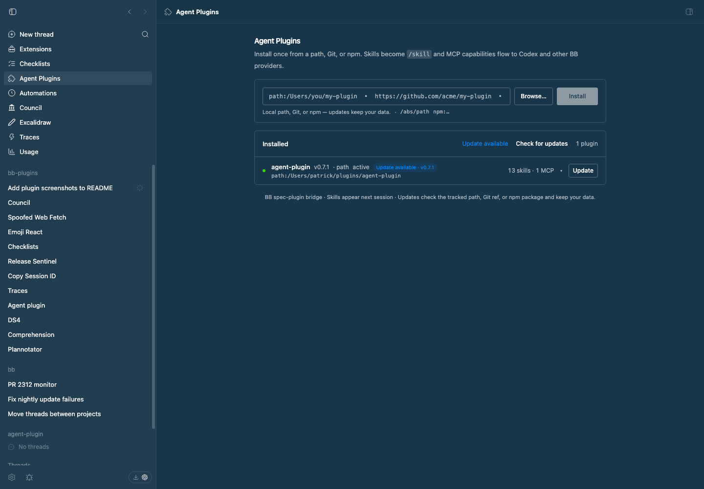

# Agent Plugins for BB

> Install from the [BB Community marketplace](https://github.com/get-bb/marketplace/pull/84) (entry pending review).

Install [Agent Plugins](https://agent-plugins.org) once in BB and use them everywhere — skills become `/skill` commands and MCP capabilities flow to Codex and other BB providers through one canonical bridge.

This is the Agent Plugins/spec-plugin integration for BB. It is not a Claude marketplace plugin and does not publish to, install from, or emulate Claude's marketplace.

Supports local paths, Git, and npm. MCP stdio, Streamable HTTP, and legacy SSE are handled by the official `@modelcontextprotocol/client` SDK.

## Staged preview



Captured from the running BB application with a live installed-plugin record.

## Install

```sh
# from the bb-plugins workspace
pnpm install
bb plugin build packages/bb-plugin-agent-plugins
bb plugin install ./packages/bb-plugin-agent-plugins --yes
```

Or install directly from git:

```sh
bb plugin install git:https://github.com/patleeman/bb-plugins.git --subdirectory packages/bb-plugin-agent-plugins --yes
```

## Use

- **UI:** Open **Agent Plugins** in the sidebar → paste a location (`/abs/path`, `https://github.com/acme/my-plugin`, `npm:my-plugin@^1.0`) or **Browse…** for a local folder → **Install**. The page checks tracked paths, Git refs, and npm sources for updates; an installed row shows **Update available** and an explicit **Update** button when the source changes. Expand an installed plugin to enable or disable each skill and MCP server independently. Disabled skills are not materialized for the next session; disabled MCP servers are removed from the bridge catalog while their approval is preserved. Supported MCP servers still need **Approve & start**; OAuth-protected HTTP servers use BB's loopback callback and expose **Authenticate**, **Reconnect**, **Reauthorize**, and **Disconnect** controls. Reconnect reuses or refreshes stored credentials; Reauthorize clears BB's local credentials and starts a fresh consent flow; Disconnect clears BB's local credentials and stops the connection. Remote grant revocation remains provider-dependent.
- **CLI:** `bb agent-plugins list --json` · `bb agent-plugins outdated --json` · `bb agent-plugins update <id>` · `bb agent-plugins show <id> --json` · `bb agent-plugins tools --json` · `bb agent-plugins tools --query "search logs" --server datadog` · `bb agent-plugins describe <opaqueId>` · `bb agent-plugins call <opaqueId> '{"text":"hello"}'` · `bb agent-plugins enable|disable <id> <serverId> [--json]`
- **Agents:** the bridge exposes `agent_plugins_list_tools`, `agent_plugins_describe_tool`, and `agent_plugins_call`. `agent_plugins_list_tools` searches the catalog (`query`, `serverId`, `limit`, `offset`) and returns compact entries without input schemas, plus a tool count per server, so large servers don't flood the context. Agents fetch schemas for the tools they pick with `agent_plugins_describe_tool`, then call them by opaque ID.

The MCP client delegates authentication to the official SDK, including protected-resource/authorization-server discovery, dynamic client registration, PKCE, refresh, `WWW-Authenticate`, insufficient-scope step-up, and OAuth callback completion. Tokens and PKCE state are stored in a BB secret setting; they are never placed in the database snapshot or frontend payload.

## Settings

Set these under **Settings → Plugins → Agent Plugins**, or with `bb plugin config agent-plugins set <key> <value>`. A change applies at once, without a reload.

| Key | Default | Meaning |
| --- | --- | --- |
| `mcpIdleStopMinutes` | `10` | Minutes a local (stdio) MCP server may go without a tool call, prompt, resource read or completion before its process is stopped. `0` keeps servers running. Fractions are accepted; the maximum is 1440. |
| `mcpConnectTimeoutSeconds` | `60` | Seconds an MCP server may take to start and list its capabilities before the attempt fails with a timeout. Between 5 and 600. |

How idle stop behaves:

- A stopped server keeps its approval and stays enabled; its status is `idle`. The next tool call, prompt, resource read or completion starts it again and returns the normal result, after the server's start-up time.
- `agent_plugins_list_tools` and `agent_plugins_describe_tool` answer for a stopped server from its last catalog and do not start it. The catalog is saved in the plugin's database, so after a BB restart a server with a saved catalog stays stopped until it is first used.
- The catalog is refreshed while the server is running (every five minutes on a catalog read, and when the server reports a change), when its configuration changes, and when no catalog is saved yet. Stopping, disabling, approving or updating a server by hand, and a server crash, discard the saved catalog, so the next catalog read starts the server.
- A server is not stopped while a request is in flight or while a resource subscription is open. The idle time counts from the end of the last request; listing tools does not count as a request.
- Streamable HTTP and SSE servers have no local process and are left connected.
- With stopping on, a log-level change is sent only to running servers.

This v0 release installs one package instance at a time. Remove an existing
plugin before installing the same package name again; removal keeps its data
unless you choose to purge it.

## Spec

Implements Agent Plugins 1.0.0 + 1.1.0 draft (tolerant closed `plugin.json`, per-server `mcp.json` isolation, `skills/` discovery, `${PLUGIN_ROOT}`/`${PLUGIN_DATA}` single-pass, `cwd` containment, header/CRLF checks). MCP tools, prompts, resources, resource templates, completions, subscriptions, structured tool output, metadata, and lifecycle/list-changed notifications are forwarded through the SDK gateway. The bridge advertises only BB capabilities it can answer; it does not claim sampling, elicitation, or roots until BB exposes those host callbacks. Vendored schemas are in `schemas/`.

## Development

```sh
pnpm --filter bb-plugin-agent-plugins typecheck
pnpm --filter bb-plugin-agent-plugins test
bb plugin build packages/bb-plugin-agent-plugins
```
